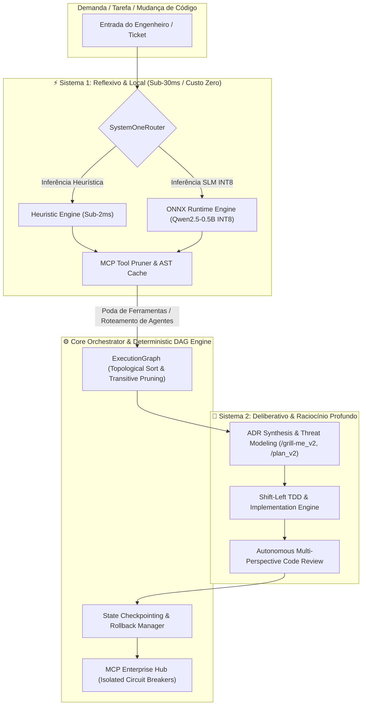
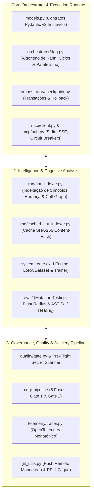
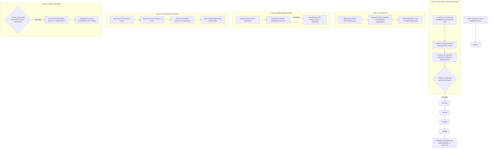

# Enterprise AI Agentic Engineering Framework (`corporate-engineer`)

[](https://www.python.org/)
[-success.svg)](./tests/)
[](./pyproject.toml)
[](https://github.com/astral-sh/ruff)
[](https://mypy.readthedocs.io/)
[](./.agents/skills/corp-pipeline/scripts/secret_scanner.py)
[](https://colab.research.google.com/github/jonatanciamarro/corporate-engineer/blob/main/notebooks/train_system_one_colab.ipynb)
[](./docs/adr/)

---

## 🔬 Resumo Teórico & Visão Geral (Abstract)

O **Enterprise AI Agentic Engineering Framework (`corporate-engineer`)** é uma infraestrutura de engenharia de software autônoma e determinística projetada para resolver o **Trilema da Engenharia de Software Agêntica**:
1. **Não-Determinismo vs. Confiabilidade**: Substituição de loops agênticos estocásticos de tentativa-e-erro por Grafos Acíclicos Dirigidos (DAGs) tipados, pontos de restauração transacionais (*checkpoints*) e testes baseados em propriedades (*Property-Based Testing* via Hypothesis).
2. **Latência & Custo de Inferência**: Implementação de uma **Arquitetura Cognitiva de Processo Duplo** (*Dual-Process Theory* - Kahneman Sistema 1 e Sistema 2), combinando roteamento reflexivo local sub-30ms via Small Language Models (SLMs) quantizados em INT8 (ONNX Runtime) com raciocínio deliberativo em nuvem (*System 2*).
3. **Governança & Conformidade Corporativa**: Enforçamento de portões formais de aprovação (*Gate 1* e *Gate 2*), Shift-Left TDD, modelagem de ameaças STRIDE, rastreabilidade distribuída (OpenTelemetry) e proteção de branches com sincronização remota obrigatória pré-PR.

---

## 🏛️ Fundamentação Arquitetural

### 1. Paradigma Cognitivo de Processo Duplo (System 1 vs. System 2)

O framework divide o esforço computacional em duas camadas complementares:



- **Sistema 1 (Fast-Path Local)**: Modelo compacto de 0.5B parâmetros (`Qwen/Qwen2.5-0.5B-Instruct`), fine-tuned via LoRA PEFT com dataset sintético de engenharia corporativa e quantizado em INT8 estático/dinâmico. Executa inferência em CPU via `onnxruntime` em **~25ms** (ou **<2ms** em fallback heurístico), realizando classificação de risco, roteamento de subagentes especializados e poda semântica de ferramentas (*Tool Pruning*).
- **Sistema 2 (Slow-Path Deliberativo)**: Orquestração de modelos de fronteira para geração formal de código, arquitetura de sistemas, prova de teoremas e revisão de conformidade.

---

### 2. Arquitetura do Sistema em 3 Camadas

O sistema é desacoplado em três camadas rigorosamente delimitadas:



---

## 🧭 O Ciclo de Vida Corporativo: Corp-Pipeline (Fases 0 a 5)

Todas as requisições de código ou mudanças estruturais são enforçadas pelo pipeline determinístico de 5 fases com dois portões obrigatórios de aprovação humana (*Human-in-the-Loop*):



---

## 🔬 Anatomia Técnica dos Módulos

### 1. `system_one/` — Motor Cognitivo Reflexivo & Treinamento SLM
- **`router.py` (`SystemOneRouter`)**: Fachada de decisões ultrarrápidas com fallback triplo: `HeuristicDecisionEngine` $\rightarrow$ `OutlinesDecisionEngine` $\rightarrow$ `ONNXNLIDecisionEngine`.
- **`nli_engine.py` (`ONNXNLIDecisionEngine`)**: Runtime de inferência direta de tensores ONNX com *lazy loading* transparente. Se o modelo não estiver compilado localmente, degrada graciosamente para o motor heurístico sem interromper a execução.
- **`dataset.py` (`SystemOneDatasetGenerator`)**: Gerador de dados sintéticos determinísticos formatados no padrão ChatML (`<|im_start|>system...<|im_start|>user...<|im_start|>assistant...`). Valida schema e distribuição equilibrada de classes de roteamento, risco e commits.
- **`trainer.py` (`SystemOneTrainer`)**: Harness de geração de notebooks interativos (`train_system_one_colab.ipynb`) e treinamento automatizado via LoRA PEFT ($r=16, \alpha=32$) com quantização INT8 direta para deploy em ambientes restritos de memória (Colab T4 com VRAM < 1.5GB).

### 2. `orchestrator/` — DAG Determinístico & Recuperação Transacional
- **`dag.py` (`ExecutionGraph`)**: Motor de grafo orientado acíclico com algoritmo de ordenação topológica de Kahn $O(V + E)$ e detecção formal de ciclos.
- **`checkpoint.py`**: Gerenciador determinístico de estado com persistência em JSON (`save_checkpoint`, `load_checkpoint`, `rollback_to_checkpoint`), permitindo rollback atômico sem perda de integridade caso nós a jusante falhem.
- **Exportação Visual**: Capacidade nativa de renderização do grafo em sintaxe Mermaid (`to_mermaid()`) para inspeção de pipelines complexos.

### 3. `mcp/` — Enterprise Model Context Protocol & Circuit Breakers
- **`client.py` (`MCPClient`)**: Cliente assíncrono para servidores MCP com suporte nativo a transportes `stdio` (subprocessos locais) e `SSE` (Server-Sent Events com autenticação Bearer token).
- **`hub.py` (`MCPEnterpriseHub`)**: Hub corporativo com suporte a arquivos de manifesto `.mcp.json`. Cada servidor é encapsulado em seu próprio **Circuit Breaker** com contagem exponencial de falhas, impedindo que lentidões ou quedas em um conector externo travem o orquestrador central. Implementa poda de ferramentas (*Tool Pruning*) guiada pelo Sistema 1 para manter o contexto do LLM limpo.

### 4. `rag/` — AST Indexer & Cache com Invalidação por Hash
- **`ast_indexer.py` (`ASTIndexer`)**: Analisador estático que percorre a Abstract Syntax Tree do Python (`ast.parse`), extraindo assinaturas de classes, métodos, herança hierárquica, imports e call graphs completos.
- **`cached_ast_indexer.py` (`CachedASTIndexer`)**: Camada de cache independente de caminhos absolutos, baseada no hash criptográfico SHA-256 do conteúdo de cada arquivo. Invalidação automática $O(1)$ quando o conteúdo sofre mutação.

### 5. `eval/` — Auto-Recuperação AST, Testes Cirúrgicos & Blast Radius
- **`fixer.py` (`ASTSelfHealingFixer`)**: Mecanismo de reescrita automática de código via manipulação sintática de nós AST (`NodeTransformer`). Corrige deterministicamente defeitos comuns como:
  - Argumentos padrão mutáveis (`def foo(x=[])` $\rightarrow$ `def foo(x=None): if x is None: x = []`).
  - Anotação de retorno ausente em métodos `__init__` (`def __init__(self) -> None:`).
  - Remoção de statements `pass` redundantes em blocos contendo código útil.
- **`surgical.py` (`SurgicalTestRunner`)**: Mapeia o `git diff` contra o grafo de dependências do AST e executa exclusivamente os testes afetados pela alteração, reduzindo o tempo de validação local de dezenas de segundos para milissegundos.
- **`impact.py` (`BlastRadiusAnalyzer`)**: Calcula o raio de alcance (*blast radius*) de qualquer alteração proposta através do grafo de dependências antes da execução de merges.

### 6. `telemetry/` — Rastreabilidade Distribuída OpenTelemetry
- **`tracer.py` (`AgentTracer`)**: Instrumentação estruturada compatível com o padrão OpenTelemetry. Captura spans com hierarquia pai-filho, latências monotônicas de alta precisão, status de execução e contadores de tokens consumidos.

### 7. `git_utils.py` — Governança de Entrega & Blindagem Pré-PR
- **Invariante 8 (Always-On Remote Push)**: O framework bloqueia a emissão de qualquer URL de PR caso a branch local não tenha sido previamente confirmada no repositório remoto (`ensure_pushed=True`), garantindo taxa de erro 404 estritamente zero.
- **Pre-Filled PR URLs**: Construção de URLs com parâmetros `quick_pull=1`, título semântico e corpo codificado (`URL-encoded`) a partir dos artefatos em `docs/pull_requests/PR-xxx.md`.

---

## 📊 Matriz Comparativa de Desempenho

| Dimensão de Análise | Heurístico Local | ONNX INT8 SLM (Qwen2.5-0.5B) | Cloud LLM (System 2) |
|---|:---:|:---:|:---:|
| **Latência Média** | `< 2 ms` | **~25 ms** | `1.200 - 3.500 ms` |
| **Consumo de Memória (RAM/VRAM)** | `< 5 MB` | **~602 MB (INT8)** | Zero local (API remota) |
| **Custo por Milhão de Chamadas** | \$0.00 | **\$0.00 (Local)** | \$5.00 - \$30.00 |
| **Confiabilidade / Determinismo** | 100% Regrado | Alta Probabilidade | Estocástico |
| **Capacidade de Raciocínio** | Rígido | Roteamento / Classificação | Síntese de Software Completa |

---

## 🛠️ Guia de Instalação e Bootstrapping

### Requisitos de Sistema
- **Python**: 3.10, 3.11 ou 3.12 (Recomendado: Python 3.11.9)
- **Sistema Operacional**: Linux, macOS ou Windows
- **Git**: 2.30+

### 1. Clonagem e Configuração do Ambiente Virtual
```bash
# Clonar o repositório
git clone https://github.com/jonatanciamarro/corporate-engineer.git
cd corporate-engineer

# Criar ambiente virtual isolado
python -m venv .venv

# Ativar ambiente virtual
# No Windows (PowerShell):
.venv\Scripts\Activate.ps1
# No Linux/macOS:
source .venv/bin/activate

# Instalar dependências completas em modo editável (incluindo testes e dev)
pip install -e ".[dev,test]"
```

---

## 💻 Catálogo de Comandos da CLI Corporativa

O framework expõe uma CLI unificada através do comando `corporate-engineer`:

```bash
# 1. Inferência Reflexiva do Sistema 1 (Roteamento de Agentes, Risco e Triagem)
corporate-engineer decide "Refactor AST parser to support async generators" --mode route --engine onnx
corporate-engineer decide "Drop foreign key constraint in users table" --mode risk --engine heuristic
corporate-engineer decide "Add health check endpoint" --mode commit

# 2. Execução da Auditoria de Qualidade Pre-Flight
corporate-engineer audit

# 3. Indexação e Análise Estática de Código (AST RAG)
corporate-engineer index src/corporate_engineer/ --output index.json

# 4. Análise de Raio de Impacto (Blast Radius)
corporate-engineer blast-radius src/corporate_engineer/models.py

# 5. Execução Cirúrgica de Testes baseada no Git Diff
corporate-engineer test-surgical

# 6. Auto-Recuperação e Refatoração Automática de Código via AST
corporate-engineer fix src/corporate_engineer/

# 7. Gerenciamento do Hub MCP (Circuit Breakers e Listagem de Ferramentas)
corporate-engineer mcp hub list
corporate-engineer mcp hub prune --threshold 0.7

# 8. Geração de Link Pré-Preenchido de Pull Request (1-Clique)
corporate-engineer pr-link --doc docs/pull_requests/PR-CORP-013.md

# 9. Gerador de Dataset Sintético para Treinamento do Sistema 1
corporate-engineer dataset generate --samples 200 --output data/system_one_dataset.jsonl
```

---

## 📜 Índice de Decisões de Arquitetura (ADRs)

Todas as alterações estruturais do framework são regidas por **Architecture Decision Records** imutáveis:

| ADR | Título & Escopo | Status | Impacto Principal |
|:---:|---|:---:|---|
| [**ADR-001**](./docs/adr/ADR-001-autonomous-corporate-engineer-architecture.md) | Autonomous Corporate Engineer Framework Architecture | 🟢 Aceito | Definição da arquitetura central desacoplada |
| [**ADR-002**](./docs/adr/ADR-002-corp-pipeline-master-orchestration-system.md) | Corp-Pipeline Master Orchestration System | 🟢 Aceito | Governança em 5 fases e 2 portões humanos |
| [**ADR-003**](./docs/adr/ADR-003-dag-mermaid-export.md) | DAG Mermaid Export Capability | 🟢 Aceito | Visualização em tempo real de grafos agênticos |
| [**ADR-004**](./docs/adr/ADR-004-ast-mutation-testing-engine.md) | AST-Based Mutation Testing Engine | 🟢 Aceito | Avaliação da robustez dos testes via mutantes |
| [**ADR-005**](./docs/adr/ADR-005-evaluation-driven-development-scorecard.md) | Evaluation-Driven Development (EDD) Scorecard | 🟢 Aceito | Métricas quantitativas de entrega de código |
| [**ADR-006**](./docs/adr/ADR-006-code-graphrag-blast-radius-impact.md) | Code GraphRAG Blast Radius Impact Analysis | 🟢 Aceito | Cálculo antecipado de impacto de alterações |
| [**ADR-007**](./docs/adr/ADR-007-opentelemetry-agent-tracing.md) | OpenTelemetry Distributed Agent Tracing | 🟢 Aceito | Rastreamento monotônico e telemetria OTel |
| [**ADR-008**](./docs/adr/ADR-008-surgical-tdd-runner-git-diff.md) | Surgical TDD Runner Based on Git Diff | 🟢 Aceito | Execução seletiva de testes dependentes |
| [**ADR-009**](./docs/adr/ADR-009-open-source-system-one-decisions.md) | Open-Source System One Fast Decisions | 🟢 Aceito | Arquitetura cognitiva de processo duplo |
| [**ADR-010**](./docs/adr/ADR-010-free-system-one-slm-finetuning-and-injection.md) | Free System One SLM Fine-Tuning & Injection | 🟢 Aceito | Treinamento gratuito de SLM via ChatML |
| [**ADR-011**](./docs/adr/ADR-011-mcp-enterprise-hub.md) | MCP Enterprise Hub Architecture | 🟢 Aceito | Circuit Breakers e poda semântica de ferramentas |
| [**ADR-012**](./docs/adr/ADR-012-ast-auto-refactor-fixer.md) | AST-Based Auto-Refactor & Self-Healing Fixer | 🟢 Aceito | Transformadores AST para auto-cura de código |
| [**ADR-013**](./docs/adr/ADR-013-system-one-slm-training-colab-onnx.md) | Google Colab Interactive SLM Training & ONNX Loader | 🟢 Aceito | Treinamento LoRA T4 e inferência local INT8 |

---

## 🔒 Invariantes de Engenharia & Governança

1. **Rastreamento Vivo de Estado (`state.md`)**: O arquivo `state.md` é a única fonte viva da verdade do projeto. Ele é lido obrigatoriamente no início de qualquer turno agêntico e atualizado formalmente ao término da entrega.
2. **Shift-Left TDD**: Nenhuma linha de código de produção é escrita antes de um teste automatizado falhar (RED). Toda funcionalidade exige no mínimo 80% de cobertura.
3. **Contratos Estritos Pydantic v2**: Proibição de dicionários soltos ou tipagem opaca (`Any`). Todos os nós e interfaces de dados implementam esquemas fortemente tipados com validação estrita.
4. **Push Remoto Mandatório Pré-PR (Invariante 8)**: Nenhuma URL de Pull Request é apresentada sem que o comando `git push -u origin <branch>` tenha sido executado e confirmado com sucesso.
5. **Zero Vazamento de Credenciais**: O scanner `secret_scanner.py` é executado antes de cada commit para garantir que nenhuma chave, token ou credencial seja adicionada ao controle de versão.

---

## 📄 Licença

Distribuído sob os padrões de governança corporativa da organização. Consulte os arquivos de licença e termos internos para detalhes de conformidade.
