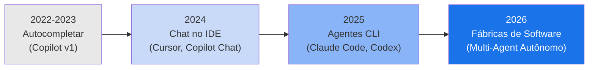
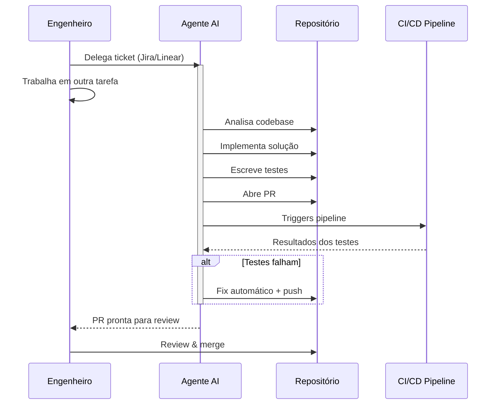
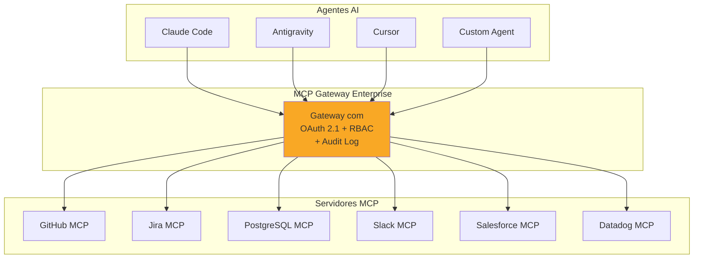
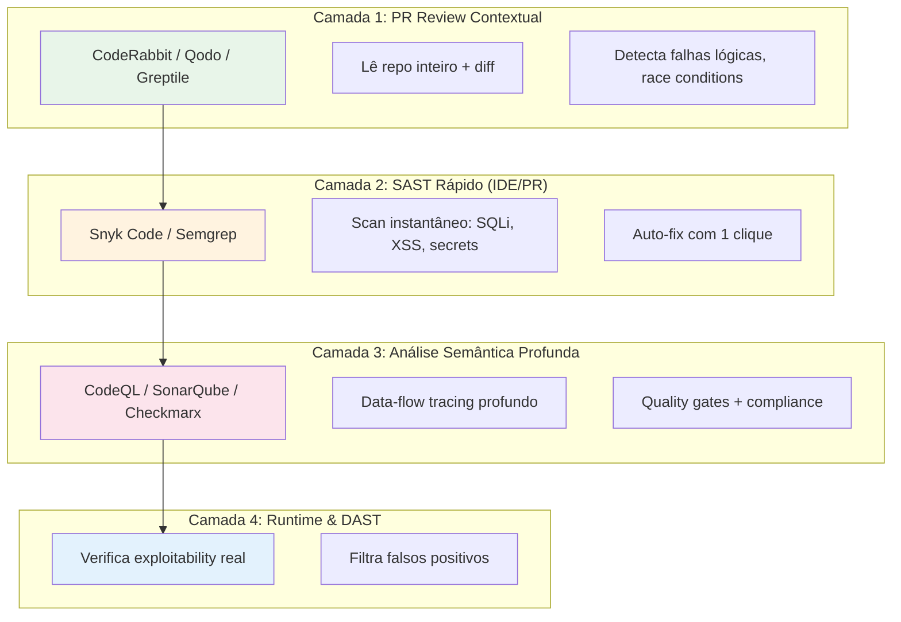
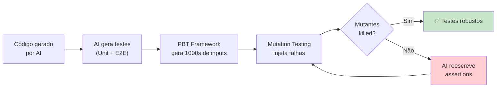
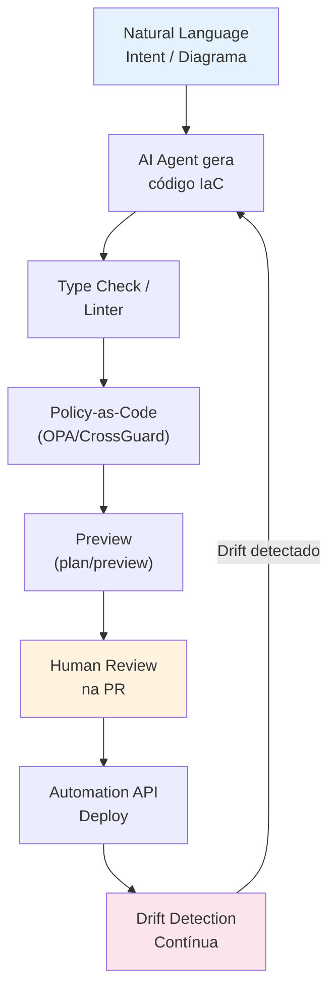
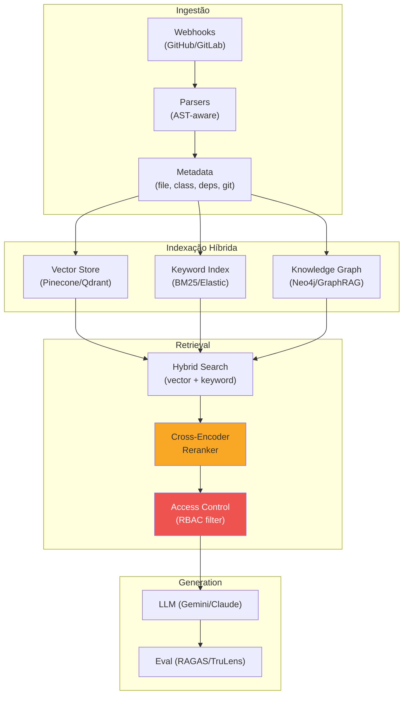
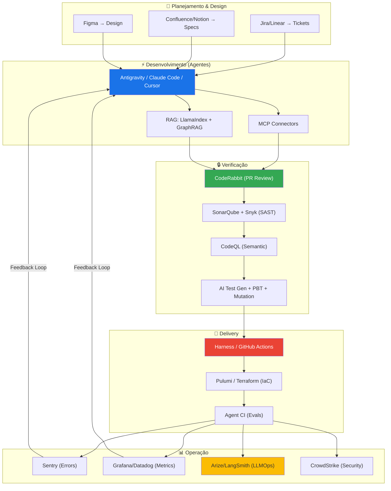

# 🔬 Deep Research: Fronteira da Engenharia de Software por IA (Nov 2026)

> [!IMPORTANT]
> Este relatório consolida pesquisa profunda sobre o estado da arte em **engenharia de software impulsionada por IA**, cobrindo agentes autônomos, orquestração multi-agente, protocolos de comunicação, segurança, testes, infraestrutura, observabilidade e conectores enterprise. Foco: **ferramentas de nível sênior para o ambiente corporativo**.

---

## 📋 Índice

1. [A Grande Mudança Paradigmática](#1-a-grande-mudança-paradigmática)
2. [Agentes Autônomos de Código](#2-agentes-autônomos-de-código)
3. [Protocolos de Interoperabilidade (MCP & A2A)](#3-protocolos-de-interoperabilidade-mcp--a2a)
4. [Orquestração Multi-Agente Enterprise](#4-orquestração-multi-agente-enterprise)
5. [Segurança & Code Review AI-Powered](#5-segurança--code-review-ai-powered)
6. [Testes AI-Powered (Geração, PBT, Mutation)](#6-testes-ai-powered-geração-pbt-mutation)
7. [CI/CD Agêntico & DevOps Autônomo](#7-cicd-agêntico--devops-autônomo)
8. [Infrastructure as Code + IA](#8-infrastructure-as-code--ia)
9. [RAG Enterprise & Indexação de Codebase](#9-rag-enterprise--indexação-de-codebase)
10. [Observabilidade & LLMOps](#10-observabilidade--llmops)
11. [Conectores Enterprise MCP](#11-conectores-enterprise-mcp)
12. [Plugins Antigravity Recomendados](#12-plugins-antigravity-recomendados)
13. [Stack Enterprise Completo Recomendado](#13-stack-enterprise-completo-recomendado)

---

## 1. A Grande Mudança Paradigmática

### O que mudou fundamentalmente:

| Dimensão | Antes (2023) | Agora (2026) |
|----------|-------------|--------------|
| **Papel do humano** | Escrevendo código | Arquiteto, revisor, orquestrador |
| **Unidade de trabalho** | Linha/função | Repositório inteiro |
| **Modelo de interação** | Autocompletar síncrono | Agentes assíncronos em background |
| **Gargalo** | Escrever código | Revisar código AI-generated |
| **Pricing** | Per-seat fixo | Usage-based / compute-based |
| **Context window** | ~8K tokens | 1M+ tokens (repositórios inteiros) |
| **Segurança** | Scan manual | Verificação contínua por agentes |

> [!NOTE]
> GitHub reporta **bilhões de commits semanais** com código AI-generated. A crise não é mais "como gerar código" — é **"como revisar, testar e deployar com confiança o volume exponencial de código gerado por IA"**.

---

## 2. Agentes Autônomos de Código

### Tier 1 — Agentes de Produção Enterprise

| Ferramenta | Tipo | Destaque Enterprise | Pricing Model |
|-----------|------|---------------------|---------------|
| **Claude Code** (Anthropic) | CLI-first agent | Integração terminal profunda, debugging multi-step, refactoring cross-file | Usage-based |
| **Devin** (Cognition) | Fully autonomous SE | Delegação de tarefas multi-dia, Jira backlog clearing, PRs com testes | Seat + compute |
| **GitHub Copilot** (Microsoft) | IDE + PR review | PR reviews automáticos, test generation, context-aware planning SDLC inteiro | Seat + usage |
| **Cursor** (Agent Mode) | AI-Native IDE | Multi-file editing, codebase-aware, composer mode | Seat-based |
| **Windsurf/Devin Desktop** | IDE + Agent | Desktop-first agent com memória persistente | Seat-based |
| **Google Antigravity** | IDE + CLI + Marketplace | Subagents, swarms, skills, plugins, MCP, workflows Python | Enterprise seat |

### Tier 2 — Open Source & Self-Hosted

| Ferramenta | Licença | Destaque |
|-----------|---------|----------|
| **OpenHands** (ex-OpenDevin) | MIT | Meta-plataforma universal, Agent Canvas, BYOM/BYOA, deploy VPC |
| **SWE-agent** (Princeton) | MIT | Benchmark acadêmico, interação direta com shell Linux |
| **Aider** | Apache 2.0 | Pair programming CLI, suporte a múltiplos LLMs |
| **Continue.dev** | Apache 2.0 | IDE extension open-source, autocomplete + chat + agents |

### Padrão Arquitetural Emergente: Agentes em Background

---

## 3. Protocolos de Interoperabilidade (MCP & A2A)

### Model Context Protocol (MCP) — O "USB-C da IA"

#### Evolução Enterprise do MCP:

| Capacidade | Implementação |
|-----------|--------------|
| **Auth centralizada** | Enterprise-managed authorization via Okta/Azure AD |
| **RBAC por agente** | Tokens scoped por role, database, e ferramenta |
| **Audit trail** | Logs completos de cada tool call por agente |
| **Data masking** | PII masking antes do LLM processar |
| **Transporte** | `stdio` (local) → HTTP remoto com OAuth 2.1 |
| **Escala** | Serverless (Cloud Run) ou Kubernetes (GKE) |

### Agent-to-Agent Protocol (A2A)

> [!TIP]
> **MCP** = como agentes se conectam a **ferramentas e dados**  
> **A2A** = como **agentes conversam entre si** (interoperabilidade cross-framework)

A2A padroniza:
- **Discovery**: agentes anunciam capacidades
- **Negotiation**: negociação de capabilities e handoff de tarefas
- **Session context**: passagem segura de contexto entre frameworks diferentes
- **Microservices pattern**: cada agente como um serviço independente

---

## 4. Orquestração Multi-Agente Enterprise

### Comparativo dos Frameworks

| Framework | Arquitetura | Melhor Para | Enterprise Features |
|-----------|------------|-------------|---------------------|
| **LangGraph** | Grafo de estado (DAG com ciclos) | Workflows mission-critical com audit trail | Checkpointing, HITL nodes, Deep Agents |
| **CrewAI** | Role-based team coordination | Prototipagem rápida, BPA | FedRAMP, VPC dedicado, GUI management |
| **Microsoft Agent Framework** | SDK unificado (ex-AutoGen + Semantic Kernel) | Ecossistema Azure/.NET | Type safety, YAML agents, telemetry |
| **AG2** (fork AutoGen) | Multi-agent conversacional | Comunidade open-source | Apache 2.0, fork independente |
| **Antigravity Swarm** | Message board multi-agente | Paralelismo nativo no IDE | Shared workspaces, model routing |

### Desafios Enterprise Críticos

> [!WARNING]
> **60-70% dos pilotos multi-agente falham antes de chegar à produção** (Gartner/Deloitte). Causas principais:

1. **Latency stacking**: handoffs sequenciais = 20-30s por execução → solução: execução assíncrona paralela
2. **Token runaway**: loops descontrolados = 3-5× budget overnight → solução: hard caps, recursion limits, context pruning
3. **Observability gap**: bugs distribuídos são impossíveis de reproduzir → solução: LangSmith/Arize + tracing OTel

---

## 5. Segurança & Code Review AI-Powered

### A Stack de Segurança em 4 Camadas

### Ferramentas-Chave por Categoria

| Categoria | Ferramenta | Diferencial Senior |
|----------|-----------|-------------------|
| **AI Code Review** | **CodeRabbit** | Review contextual de PR inteiro, multi-repo, auto-fix |
| **AI Code Review** | **Qodo (ex-CodiumAI)** | Geração de testes + review + análise de coverage |
| **AI Code Review** | **Greptile** | Indexação semântica de codebase para review profundo |
| **SAST AI** | **Snyk Code** | ML engine + data-flow analysis, 1-click fix |
| **SAST Rules** | **Semgrep** | Custom rules + guardrails para código AI-generated |
| **Quality Gate** | **SonarQube** | 7500+ rules, tech debt tracking, compliance |
| **Semantic** | **CodeQL** (GitHub) | Código como dados, queries semânticas + Copilot Autofix |
| **ASPM** | **Apiiro** | Reachability analysis, filtra falsos positivos |
| **Security AI** | **CrowdStrike Falcon** | Threat intel, SIEM, detecção end-to-end |

---

## 6. Testes AI-Powered (Geração, PBT, Mutation)

### Arquitetura de Testes em 3 Pilares

| Pilar | Finalidade | Ferramentas |
|-------|-----------|-------------|
| **Geração** | Cobertura rápida de código AI-generated | testRigor, ACCELQ, Shiplight AI, Claude Code |
| **Property-Based Testing** | Invariantes matemáticas/lógicas | Hypothesis (Python), jqwik (Java), fast-check (JS) + LLM |
| **Mutation Testing** | Validar qualidade dos testes gerados | Pitest (Java), StrykerJS (TS/JS) + AI analysis |

### Fluxo Senior de Test Quality

> [!TIP]
> **Property-Based Testing + LLMs** é a combinação mais poderosa de 2026. O LLM é excelente em identificar propriedades matemáticas (Roundtrip, Idempotência, Invariantes, Comutatividade) que humanos frequentemente esquecem.

### Ferramentas de Teste Enterprise

| Ferramenta | Tipo | Diferencial |
|-----------|------|-------------|
| **testRigor** | No-code/plain English E2E | Testes escritos em inglês, auto-healing de locators |
| **ACCELQ** | Codeless enterprise | Generative AI para requisitos → cenários de teste |
| **Shiplight AI** | MCP-based browser testing | Integra com Claude Code/Cursor via MCP |
| **Tricentis Tosca** | Model-based enterprise | Risk-coverage analysis, cross-platform |
| **Mabl** | Low-code cross-browser | Auto-healing, visual regression |

---

## 7. CI/CD Agêntico & DevOps Autônomo

### De CI/CD Estático para "Agent CI"

| Dimensão | CI/CD Tradicional | Agent CI (2026) |
|----------|-------------------|-----------------|
| **Trigger** | Push/merge | Push + AI drift detection + eval failure |
| **Falha** | Alerta para humano | Agente lê logs, aplica fix, re-testa |
| **Teste** | Pass/fail binário | Evals semânticos contínuos (EDD) |
| **Environment** | Staging fixo | Preview environments dinâmicos per-branch |
| **Deploy** | Pipeline determinístico | Pipeline + AI com human-in-the-loop gate |

### Ferramentas de CI/CD Enterprise

| Ferramenta | Tipo | Diferencial Enterprise |
|-----------|------|----------------------|
| **Harness** | Autonomous SDLC | AI failure remediation, multi-cloud deploy, pipelines inteligentes |
| **GitHub Actions** | CI/CD nativo | Copilot Autofix integrado, CodeQL, GHAS |
| **GitLab Duo** | DevSecOps completo | AI em cada stage do pipeline |
| **CircleCI** | CI/CD cloud | Predictive failure analysis |
| **Northflank** | Multi-env orchestration | Preview environments automatizados |
| **Agent-CI** | Eval-driven CI | Evals semânticos em cada PR |

### Evaluation-Driven Development (EDD)

> [!IMPORTANT]
> **EDD** é o paradigma emergente que substitui testes binários por avaliações contínuas semânticas. Cada PR é avaliada não apenas por "passa/falha", mas por métricas de acurácia semântica, performance, segurança e guardrails.

---

## 8. Infrastructure as Code + IA

### Terraform/OpenTofu vs. Pulumi — A Visão de 2026

| Critério | Terraform/OpenTofu | Pulumi |
|----------|-------------------|--------|
| **Linguagem** | HCL (domain-specific) | Python, TypeScript, Go, C#, Java |
| **AI-friendliness** | Enorme training data público | Compiladores nativos validam antes do deploy |
| **Licença** | BSL (Terraform) / MPL 2.0 (OpenTofu) | Open Source + Enterprise |
| **MCP Server** | Terraform MCP Server | Pulumi AI / Neo |
| **Policy-as-Code** | OPA/Rego, Sentinel | Pulumi CrossGuard |
| **AI Agent Integration** | Via MCP + HCL generation | Linguagem nativa = type-checking automático |

### Pipeline Enterprise IaC + AI

### Ferramentas Complementares

| Ferramenta | Função |
|-----------|--------|
| **Spacelift** | Orquestração IaC enterprise com AI intelligence |
| **Env0** | IaC management + cost governance |
| **Pulumi Neo** | NL → IaC com policy validation |
| **OpenTofu** | Fork open-source do Terraform (CNCF) |

---

## 9. RAG Enterprise & Indexação de Codebase

### Arquitetura RAG Moderna para Código

### Ferramentas RAG Enterprise

| Categoria | Ferramenta | Diferencial |
|----------|-----------|-------------|
| **Platform Enterprise** | **Glean / Onyx AI** | Search interno unificado, ACL nativo, 100+ connectors |
| **RAG-as-a-Service** | **Vectara** | Pipeline E2E, hallucination detection |
| **Framework** | **LlamaIndex** | 300+ connectors, LlamaParse, hierachical indexing |
| **Framework** | **LangChain/LangGraph** | Agentic RAG, dynamic multi-step retrieval |
| **OSS Engine** | **RAGFlow** | Layout analysis, OCR, table recognition |
| **Graph** | **LightRAG / GraphRAG** | Traversal de dependências, queries globais |
| **Graph DB** | **Neo4j** | Knowledge graph enterprise, GDS algorithms |
| **Vector DB** | **Pinecone / Qdrant / Weaviate** | Hybrid search, multi-tenancy, ACL |
| **Search** | **Elasticsearch / Meilisearch** | Keyword + typo tolerance + syntax tokens |

### Best Practices Senior

> [!CAUTION]
> **Nunca pule o reranking!** Retrieve 50-100 chunks → Cross-encoder reranker → Top 5. Isso reduz drasticamente ruído e custo de tokens.

- ✅ **AST-aware chunking** (não chunks por caracteres)
- ✅ **Streaming ingestion** via webhooks (não batch noturno)
- ✅ **Access-aware RAG** (permissões do repo no metadata do vector)
- ✅ **Avaliação contínua** com RAGAS/TruLens no CI/CD
- ✅ **GraphRAG** para queries cross-service ("como flui a autenticação?")

---

## 10. Observabilidade & LLMOps

### Comparativo Enterprise

| Plataforma | Melhor Para | Padrão Aberto? | Destaque |
|-----------|------------|----------------|----------|
| **LangSmith** | Ecossistema LangChain/LangGraph | Proprietário | UI de debugging multi-step, eval loops |
| **Arize AI** | ML + LLM unificado, RAG eval | OpenTelemetry + OpenInference | Phoenix OSS, embedding drift |
| **Arize Phoenix** | Local-first debugging | Open-source | Notebook-friendly, eval em dev |
| **W&B Weave** | Teams com experiment tracking existente | Proprietário | `@weave.op` decorator, ML+LLM unificado |
| **Langfuse** | Self-hosted, budget-friendly | Open-source | SOC 2, RBAC, PII redaction |

### Capacidades Críticas para Enterprise

| Capacidade | Por que é essencial |
|-----------|-------------------|
| **Agent-aware tracing** | LLMs falham silenciosamente (HTTP 200 + hallucination) |
| **OpenTelemetry** | Evita vendor lock-in, switch de backend |
| **LLM-as-a-Judge** | Avaliação contínua de qualidade em produção |
| **PII Redaction** | Compliance LGPD/GDPR |
| **Self-hosted option** | Air-gapped environments, dados sensíveis |

---

## 11. Conectores Enterprise MCP

### Plataformas de Integração MCP

| Plataforma | Tipo | Diferencial |
|-----------|------|-------------|
| **CData Connect AI** | Managed MCP gateway | 100s de ERPs/CRMs/DBs, RBAC nativo |
| **Composio** | Pre-built toolkits | OAuth per-user, 100+ SaaS apps |
| **Arcade.dev** | Tool execution platform | User-scoped auth, enterprise-grade |
| **Workato** | Enterprise iPaaS | Workflows → MCP servers, 1000+ connectors |
| **Pipedream** | Developer automation | Low-code MCP server creation |
| **Nango** | Auth & sync | White-labeled per-user auth, DLP |
| **Merge** | Unified API | HR/ATS/CRM/Accounting unified connectors |
| **Zapier** | Workflow automation | 9000+ apps, MCP-compatible |

### Use Cases Enterprise Concretos

| Área | Exemplo | Ferramentas MCP |
|------|---------|----------------|
| **Incident Response** | AI lê Sentry/Datadog, correlaciona com Jira, sugere playbook | Sentry MCP, Jira MCP, Datadog MCP |
| **Finance & Compliance** | Query de transações com masking de PII | PostgreSQL MCP, Snowflake MCP |
| **Sales Analytics** | Análise de pipeline CRM em NL | Salesforce MCP, HubSpot MCP |
| **Dev Workflow** | Agente resolve ticket → implementa → abre PR → notifica Slack | GitHub MCP, Linear MCP, Slack MCP |
| **Security** | Threat hunting, detecção, investigação | CrowdStrike MCP, SentinelOne MCP |

---

## 12. Plugins Antigravity Recomendados

### Para o Stack Enterprise Completo

| Plugin | ID | Categoria | O que faz |
|--------|----|-----------|-----------| 
| **Google Cloud Developer** | `antigravity-plugins-official/plugin/google-cloud-developer` | Cloud/IaC | Onboarding GCP, auth, validação de gcloud CLI |
| **CodeRabbit** | `antigravity-plugins-partners/plugin/coderabbit` | Code Review | AI code review, autofix de comentários |
| **SonarQube** | `antigravity-plugins-partners/plugin/sonarqube` | Quality/Security | 7500+ rules no loop de coding do agente |
| **Harness** | `antigravity-plugins-partners/plugin/harness-antigravity` | CI/CD | Pipelines, deploys, security findings |
| **Sentry** | `antigravity-plugins-partners/plugin/sentry` | Monitoring | Erros de produção, alertas, releases |
| **Grafana Cloud** | `antigravity-plugins-partners/plugin/grafana-cloud-mcp` | Observability | Métricas, logs, traces, dashboards |
| **CrowdStrike Falcon** | `antigravity-plugins-partners/plugin/crowdstrike` | Security | Threat intel, SIEM, detecção |
| **SentinelOne Purple AI** | `antigravity-plugins-partners/plugin/sentinelone-purple-mcp` | Security | Query Singularity Console via MCP |
| **Atlassian (Jira/Confluence)** | `antigravity-plugins-partners/plugin/atlassian-twg-cli` | Project Mgmt | Issues, pages, PRs, contexto de trabalho |
| **Zapier** | `antigravity-plugins-partners/plugin/zapier` | Automation | 9000+ apps, execução de workflows |
| **Neo4j** | `antigravity-plugins-partners/plugin/neo4j` | Graph DB | Cypher, GraphRAG, GDS algorithms |
| **Postman** | `antigravity-plugins-partners/plugin/postman` | API Lifecycle | Design, test, document, mock, monitor APIs |
| **Supabase** | `antigravity-plugins-partners/plugin/supabase` | Backend/DB | Auth, storage, Postgres, project mgmt |
| **Data Agent Kit** | `antigravity-plugins-official/plugin/data-agent-kit-plugin` | Data Eng | BigQuery, AlloyDB, Spanner, Dataflow |
| **Gemini API** | `antigravity-plugins-official/plugin/gemini-api` | AI/ML | Build AI apps com Gemini, Live API, agents |

---

## 13. Stack Enterprise Completo Recomendado

### Visão Integrada da "Software Factory" AI-Native

### Resumo Executivo: Top 10 Recomendações Senior

| # | Recomendação | Impacto | Urgência |
|---|-------------|---------|----------|
| 1 | **Adotar MCP como padrão** de integração de ferramentas | 🔴 Crítico | Imediato |
| 2 | **CodeRabbit + SonarQube** no pipeline de PR | 🔴 Crítico | Imediato |
| 3 | **Agentes em background** (Claude Code/Antigravity) para tasks assíncronas | 🟠 Alto | Curto prazo |
| 4 | **Evaluation-Driven Development** (EDD) em vez de apenas unit tests | 🟠 Alto | Curto prazo |
| 5 | **RAG com AST-aware chunking + reranking** para codebase search | 🟡 Médio | Médio prazo |
| 6 | **Mutation testing** (Pitest/Stryker) para validar qualidade de testes AI | 🟡 Médio | Médio prazo |
| 7 | **LLMOps** (Arize/LangSmith) para observabilidade de agentes | 🟠 Alto | Curto prazo |
| 8 | **A2A protocol** para interop cross-framework | 🟡 Médio | Médio prazo |
| 9 | **Pulumi + AI** para IaC type-safe com validação pre-deploy | 🟡 Médio | Médio prazo |
| 10 | **Property-Based Testing com LLMs** para edge cases automáticos | 🟢 Alto ROI | Contínuo |

---

> [!NOTE]
> **Pesquisa realizada em Novembro 2026.** Este campo evolui semanalmente. Recomenda-se revisão trimestral das ferramentas e protocolos listados.

---

*Compilado por Antigravity Deep Research Agent • 12 eixos de pesquisa • 40+ fontes analisadas*
