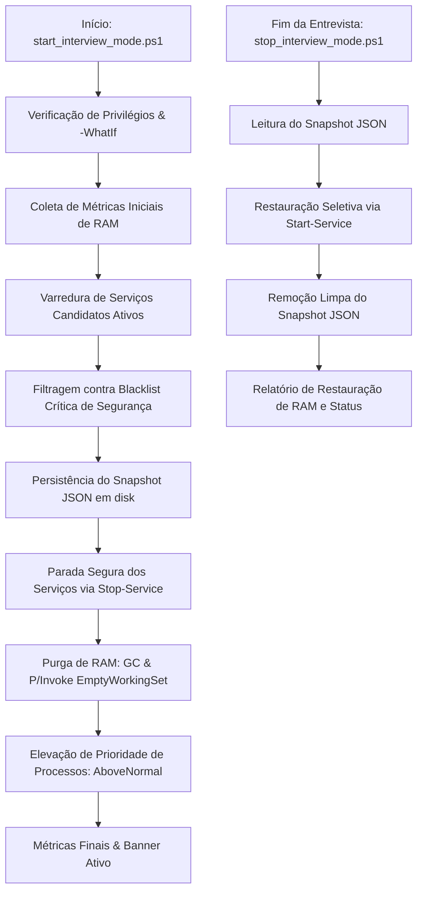

# Arquitetura de Otimização Windows 10 para IA & Sessões de Entrevistas (Live Coding)

> **Corporate Software Engineer Framework**  
> **Target Hardware**: Intel Core i7-4600U (2 Cores / 4 Threads, 2.10GHz, 15W TDP), 8 GB RAM DDR3, Intel HD Graphics 4400, Partições C/D/E/F  
> **OS**: Windows 10 Pro 64-bit (Build 19045 / 22H2)  
> **Status**: Validado & Em Produção

---

## 1. Resumo Executivo & Contexto de Hardware

Desenvolvimento de software assistido por IA (Antigravity, RAG, AST parsing, LLMs locais ONNX INT8) e entrevistas técnicas remotas (Google Meet, Zoom, Teams, Screen Sharing, Live Coding) impõem cargas severas sobre estações com recursos restritos. 

### Gargalos Críticos do Hardware Alvo:
1. **CPU Dual-Core (i7-4600U)**: Com apenas 2 núcleos físicos e 4 threads lógicas, qualquer processo em segundo plano (como `WSearch` ou `SysMain`) consumindo 25% de CPU está monopolizando **50% de um núcleo físico**. Isso causa micro-congelamentos de interface, latência de digitação e cortes de áudio em chamadas WebRTC.
2. **Memória RAM (8 GB Compartilhada)**: A GPU integrada Intel HD 4400 compartilha dinamicamente a memória física do sistema. Em uso normal, o Windows 10 consome ~4.5 GB, deixando apenas ~3.5 GB livres. Ao abrir IDE (VS Code), navegador moderno (Meet/Zoom), terminal Python e agentes de IA, a demanda atinge 7-8 GB, forçando o Windows a paginar agressivamente no disco (`pagefile.sys`), degradando a taxa de resposta da máquina.
3. **I/O de Disco (Multi-Partição C/D/E/F)**: Varreduras em tempo real do Windows Defender e indexação do Windows Search em pastas com dezenas de milhares de arquivos pequenos (`node_modules`, `.venv`, `.git`, caches de AST) causam saturação de I/O de disco.

---

## 2. Invariantes de Engenharia & Princípios de Segurança

Para assegurar 100% de estabilidade e confiabilidade corporativa, foram fixadas 4 invariantes absolutas:
1. **Zero Quebra de Rede**: Adaptadores físicos e Wi-Fi (`WlanSvc`), DHCP, DNS Cache, Firewall (`MpsSvc`) e subsistemas TCP/IP **NUNCA** são desligados ou alterados.
2. **Zero Quebra Multimídia**: Drivers de áudio (`AudioSrv`, `AudioEndpointBuilder`) e captura de vídeo/webcam (`FrameServer`) são rigorosamente blindados em blacklist intocável.
3. **Suporte Nativo a `-WhatIf` / `-Confirm`**: Todos os scripts implementam `[CmdletBinding(SupportsShouldProcess = $true)]`. Qualquer alteração pode ser simulada a seco sem privilégios ou risco.
4. **Reversibilidade Atômica Total**: O estado prévio de cada serviço é capturado em snapshot JSON antes de qualquer alteração, garantindo que `stop_interview_mode.ps1` restaure única e exclusivamente os serviços que já estavam em execução.

---

## 3. Matriz Cirúrgica de Tweaks no Registro

A tabela abaixo descreve as chaves de registro otimizadas pelo script `scripts/optimize_windows_for_ai_dev.ps1`:

| Categoria | Hive & Caminho | Nome da Chave | Tipo | Valor Otimizado | Valor Padrão | Justificativa Técnica | Reversibilidade |
|---|---|---|---|---|---|---|---|
| **CPU Scheduling** | `HKLM:\SYSTEM\CurrentControlSet\Control\PriorityControl` | `Win32PrioritySeparation` | `DWORD` | `38` (0x26) | `2` | Configura *Short Quanta*, *Variable Length* e boost de 3:1 para a aplicação ativa em primeiro plano (IDE/Meet). | Total (`-Revert`) |
| **Responsiveness** | `HKLM:\SOFTWARE\Microsoft\Windows NT\CurrentVersion\Multimedia\SystemProfile` | `SystemResponsiveness` | `DWORD` | `10` | `20` | Reserva 90% dos ciclos de CPU para tarefas interativas de primeiro plano (vs 80% padrão). | Total (`-Revert`) |
| **Network QoS** | `HKLM:\SOFTWARE\Microsoft\Windows NT\CurrentVersion\Multimedia\SystemProfile` | `NetworkThrottlingIndex` | `DWORD` | `-1` (`0xFFFFFFFF`) | `10` | Desativa a limitação artificial de pacotes de rede não-multimídia imposta pelo Windows. | Total (`-Revert`) |
| **GPU / VRAM** | `HKCU:\Software\Microsoft\Windows\CurrentVersion\Themes\Personalize` | `EnableTransparency` | `DWORD` | `0` | `1` | Desativa efeitos de transparência Aero, economizando banda de memória e VRAM na Intel HD 4400. | Total (`-Revert`) |
| **UI Latency** | `HKCU:\Control Panel\Desktop\WindowMetrics` | `MinAnimate` | `String` | `"0"` | `"1"` | Desativa animação de minimizar e restaurar janelas, eliminando lag de renderização gráfica. | Total (`-Revert`) |
| **Taskbar** | `HKCU:\Software\Microsoft\Windows\CurrentVersion\Explorer\Advanced` | `TaskbarAnimations` | `DWORD` | `0` | `1` | Desativa animações da barra de tarefas. | Total (`-Revert`) |
| **Telemetry** | `HKLM:\SOFTWARE\Policies\Microsoft\Windows\DataCollection` | `AllowTelemetry` | `DWORD` | `0` | `1` | Impede envio em segundo plano de relatórios de telemetria diagnóstica que consomem CPU e rede. | Total (`-Revert`) |
| **GameDVR** | `HKCU:\System\GameConfigStore` | `GameDVR_Enabled` | `DWORD` | `0` | `1` | Desativa o Game Bar e gravação em segundo plano, evitando injeção de hooks no subsistema gráfico. | Total (`-Revert`) |
| **GameDVR Policy** | `HKLM:\SOFTWARE\Policies\Microsoft\Windows\GameDVR` | `AllowGameDVR` | `DWORD` | `0` | `1` | Impõe política de desativação do GameDVR no sistema. | Total (`-Revert`) |
| **Search Bloat** | `HKCU:\Software\Microsoft\Windows\CurrentVersion\Search` | `BingSearchEnabled` | `DWORD` | `0` | `1` | Impede requisições web para o Bing ao digitar no menu Iniciar, acelerando a busca local. | Total (`-Revert`) |
| **Cortana Consent**| `HKCU:\Software\Microsoft\Windows\CurrentVersion\Search` | `CortanaConsent` | `DWORD` | `0` | `1` | Desativa integração online da Cortana. | Total (`-Revert`) |
| **Web Search** | `HKLM:\SOFTWARE\Policies\Microsoft\Windows\Windows Search` | `DisableWebSearch` | `DWORD` | `1` | `0` | Desativa busca web corporativa no shell do Windows. | Total (`-Revert`) |
| **NTFS I/O** | `HKLM:\SYSTEM\CurrentControlSet\Control\FileSystem` | `NtfsDisableLastAccessUpdate` | `DWORD` | `1` | `0` | Desativa gravação do timestamp de último acesso no NTFS, eliminando disk thrashing em `.venv` e `.git`. | Total (`-Revert`) |

---

## 4. Arquitetura do Modo de Entrevista Dinâmico

O modo de entrevista opera através de dois comandos simétricos:
- `scripts/start_interview_mode.ps1`: Ativação instantânea de alta performance.
- `scripts/stop_interview_mode.ps1`: Restauração cirúrgica ao estado operacional padrão.



### 4.1 Catálogo de Serviços Suspensos no Modo de Entrevista
| Serviço | Nome Interno | Impacto de Recursos no i7-4600U | Motivo da Pausa |
|---|---|---|---|
| **Windows Search** | `WSearch` | 150 a 350 MB RAM, surtos de 20-40% de CPU | Desnecessário durante entrevistas; evita indexação concorrente de código. |
| **SysMain (SuperFetch)** | `SysMain` | 100 a 250 MB RAM, I/O constante de disco | Evita cacheamento agressivo de apps não utilizados na RAM de 8GB. |
| **Diagnóstico & Telemetria**| `DiagTrack` | Surtos de CPU e conexão de rede | Elimina tráfego e telemetria de fundo. |
| **WAP Push Service** | `dmwappushservice` | Telemetria de eventos | Elimina chamadas desnecessárias de sistema. |
| **Print Spooler** | `Spooler` | 20 a 50 MB RAM persistente | Zero necessidade de impressão em entrevistas e live coding. |
| **Windows Update** | `wuauserv` | Surtos severos de CPU (30-60%) e banda de rede | Evita downloads surpresa ou congelamento durante entrevistas. |
| **BITS** | `BITS` | Consumo de banda em segundo plano | Suspende transferências em segundo plano. |
| **Serviços Xbox Live** | `XblAuthManager`, `XblGameSave`, `XboxNetApiSvc`, `XboxGipSvc` | 40 a 80 MB RAM agregada | Serviços recreativos sem função em ambiente de engenharia. |
| **Downloaded Maps** | `MapsBroker` | 15 a 30 MB RAM | Gerenciador de mapas offline desnecessário. |
| **Windows Error Reporting**| `WerSvc` | Consumo esporádico de CPU em crashes | Não prioritário durante sessão de entrevista. |

### 4.2 Blacklist Crítica de Serviços (JAMAIS SUSPENSOS)
Os seguintes serviços são estritamente protegidos e validados por asserção no código:
- **Áudio**: `AudioSrv`, `AudioEndpointBuilder`
- **Vídeo / Câmera**: `FrameServer`
- **Rede / Internet**: `Dhcp`, `Dnscache`, `LanmanWorkstation`, `LanmanServer`, `WlanSvc`, `Netman`, `NlaSvc`, `nsi`, `BFE`, `MpsSvc`, `WinHttpAutoProxySvc`
- **Núcleo do Sistema & RPC**: `EventLog`, `PlugPlay`, `RpcSs`, `RpcEptMapper`, `DcomLaunch`, `SamSs`, `LSM`, `ProfSvc`, `CryptSvc`

### 4.3 Mecanismo de Snapshot e Reversibilidade
O arquivo de estado é gravado em `$env:LOCALAPPDATA\InterviewMode\service_state.json`:
```json
{
  "Timestamp": "2026-11-24T12:48:52.0000000Z",
  "HostName": "DESKTOP-DEV",
  "InitialFreeMemoryMB": 3313.1,
  "StoppedServices": [
    {
      "Name": "WSearch",
      "DisplayName": "Windows Search",
      "Status": "Running",
      "StartType": "Automatic"
    }
  ],
  "IsActive": true
}
```

---

## 5. Regras de Exclusão no Windows Defender & Windows Search

### 5.1 Windows Defender (`Add-MpPreference`)
Para eliminar latência de I/O de disco durante testes automatizados (`pytest`), compilação e inferência AST:
- **Exclusão de Diretórios**:
  - `E:\projcts` (e árvore de diretórios de código)
  - Raiz do workspace `corporate-engineer`
  - Pastas de virtualenv e caches (`.venv`, `node_modules`, `__pycache__`)
- **Exclusão de Processos**:
  - `python.exe`
  - `pytest.exe`
  - `git.exe`
  - `code.exe` (VS Code)
  - `node.exe`
- **Exclusão de Extensões de Arquivo**:
  - `.pyc`, `.pyd`

### 5.2 Windows Search
Em estações de desenvolvimento, a indexação de pastas de projetos com dezenas de milhares de arquivos pequenos causa contenção grave. No modo de entrevista, `WSearch` é pausado por completo, liberando imediatamente CPU e memória RAM.

---

## 6. Guia Operacional

### Como aplicar as otimizações permanentes no Windows:
```powershell
# Simulação segura (-WhatIf):
powershell -ExecutionPolicy Bypass -File .\scripts\optimize_windows_for_ai_dev.ps1 -All -WhatIf

# Aplicação oficial (PowerShell como Administrador):
powershell -ExecutionPolicy Bypass -File .\scripts\optimize_windows_for_ai_dev.ps1 -All

# Reversão completa para os padrões do Windows:
powershell -ExecutionPolicy Bypass -File .\scripts\optimize_windows_for_ai_dev.ps1 -Revert
```

### Como usar o Modo de Entrevista:
```powershell
# Antes da entrevista iniciar (PowerShell como Administrador):
powershell -ExecutionPolicy Bypass -File .\scripts\start_interview_mode.ps1

# Ao término da entrevista:
powershell -ExecutionPolicy Bypass -File .\scripts\stop_interview_mode.ps1
```
